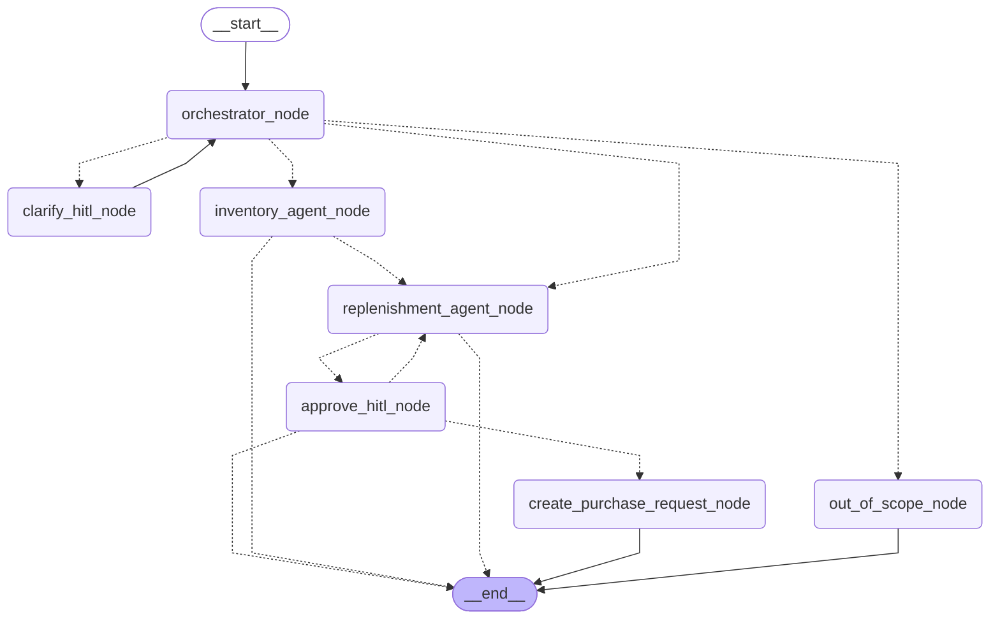

# Inventra - Agentic Warehouse Stockout Resolution

Inventra is a multi-agent system that helps an inventory manager prevent avoidable stockouts. For a single SKU in a single warehouse, it investigates whether stock is at risk, prepares a grounded replenishment proposal, pauses for human approval, and safely creates a purchase request - all from evidence already sitting in the existing systems, never from guesswork.

**Live:** [Inventra api is live in production](https://inventra-production-226654822435.asia-south1.run.app/docs)  
**Docs:** [DESIGN.md](DESIGN.md) - The problem of our design | [ARCHITECTURE.md](ARCHITECTURE.md) - The system's detailed design

## Features

- **Deterministic vs agentic split** - tools own every calculation and verdict; the LLM only interprets, picks from validated options, and explains.
- **Multi-agent system** - two specialist agents, each with a narrow, well-defined job.
- **Orchestrator pattern** - a centralized architecture pattern where an LLM router interprets the request and decides which agent handles it, what needs clarifying, and what is out of scope.
- **Human-in-the-loop** - the graph pauses for a person whenever consent is required, and resumes from the same checkpoint.
- **Tool calling** - agents gather evidence through typed tools instead of recalling facts.
- **Tool access control** - a per-agent allowlist; each agent can call only the tools its role needs.
- **Contained input/output schemas** - inputs reject anything not declared, outputs are frozen so no downstream step can alter a result.
- **Grounded in evidence** - every figure traces back to a database record through evidence references.
- **Fail-closed** - stale, missing or insufficient data stops the case with a stated reason instead of guessing past it.
- **Idempotent writes** - orders are created only by code, keyed so one approval can never place two.
- **Centralized configuration** - every threshold and boundary lives in one frozen config object, never hardcoded in prompts or nodes.
- **Testing** - every capability covered branch by branch, including the failure paths, with fakes forcing the cases the seed data can't reach.
- **CI/CD** - shipped to GCP using Cloud Build, Cloud Deploy, Cloud Run, Artifact Registry and Cloud SQL; tests and image build on PR, full pipeline with staging and approval on merge.

## Tech stack

- **Core** - Python, LangGraph, LangChain, OpenAI, Pydantic
- **API** - FastAPI, Uvicorn
- **Data** - SQLite (app data), Postgres (checkpoints)
- **Testing** - Pytest
- **Infrastructure** - Docker, Cloud Run, Cloud Build, Cloud Deploy, Artifact Registry, Secret Manager, Cloud SQL


## Run

1. Getting started
```bash
git clone https://github.com/VikibeKSumi/Inventra.git
cd Inventra
python -m venv .venv && .venv\Scripts\activate
pip install -r requirements.txt
```

2. Create a `.env` with your key:
```
OPENAI_API_KEY=sk-...
```

3. Start Postgres for the checkpointer:
```bash
docker run --name inventra-pg -e POSTGRES_PASSWORD=dev -e POSTGRES_DB=inventra -p 5432:5432 -d postgres:16
```

4. Run it
```bash
python -m run                 # CLI
uvicorn app:app --reload      # API at localhost:8000/docs
pytest -q                     # tests
```

> The database is a fixed seed anchored to 2026-08-30, and the clock is pinned to match, so results are reproducible.

## Graph workflow



## Non-goals
- It does not monitor - nothing runs on a schedule; a case starts because someone asked
- It does not handle portfolios - one SKU, one warehouse, one case
- It does not place orders - it creates an internal purchase request; transmitting and tracking it are outside the boundary
- It does not own its data - stock and sales belong to other systems; it reads them and refuses to proceed on stale evidence
- It does not decide to spend - every purchase needs a named human approval
- It does not forecast - sales pace is a recent average, not a model of seasonality or promotions


## Known limitations (broken, missing, or unsafe)
- The revise loop has no effect - the approver's comment and requested revision are captured but never read, so a revision rebuilds the identical proposal
- The container filesystem is ephemeral, so purchase orders are lost when an instance restarts
- `case_id` is derived from sku + warehouse, so two genuinely separate orders look like duplicates to the idempotency guard
- No revalidation before the write - data could change while a human is deciding
- Both services are public (`invoker-iam-disabled: true`) - an endpoint that creates purchase orders, open to the internet
- The clarification loop isn't capped
- No retries on transient LLM failures - a timeout ends the case as blocked
- No automated evaluation of decision quality
- No tracing or metrics in production
- The audit trail isn't written - `audit_events` exists in the schema but nothing inserts

## Roadmap
- **Postgres for app data** - makes orders durable and idempotency reliable across instances
- **Revision feedback** - feed the approver's comment back into the proposal so a revise actually changes something
- **Revalidation before the write** - re-check the approved proposal against current data
- **Locked-down endpoints** - require IAM auth instead of public access
- **Evaluation suite** - scored cases for routing and outcome accuracy, run on every prompt change
- **Tracing and metrics** - per-case cost, latency and terminal reasons
- **User interface** - render proposals and collect approvals
